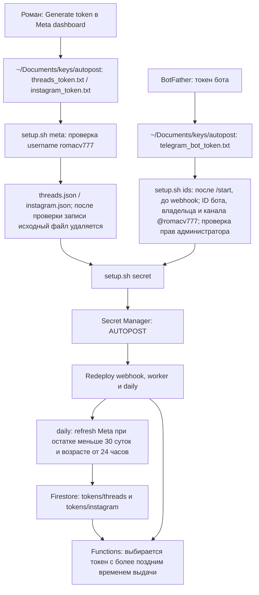
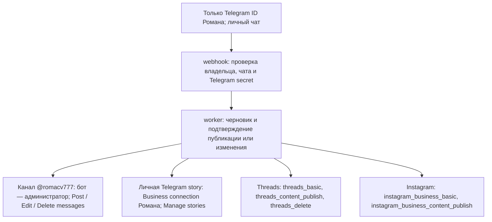
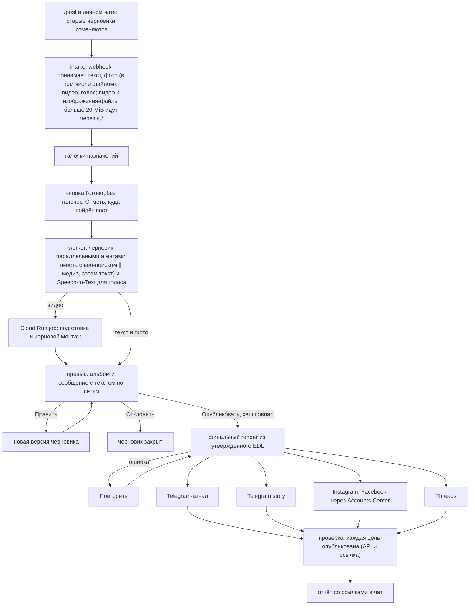

# Автопостер на Firebase

Роман отправляет боту текст, фото, голос или видео. Бот готовит черновик и финальные файлы, показывает их в личном чате и ждёт «Опубликовать». Каждый пост — одна сессия от приёма до конца (`sessions/<item>`): она закрывается ровно одним исходом — «опубликован» после проверки целей или «отменён». Подтверждение привязано к конкретным текстам и байтам медиа. Новый пост начинается командой /post, а фото, видео, голос или файл без открытого поста (после публикации, отмены или при операции над постом) тоже открывают новый пост без отмены черновиков; пока черновик открыт, новый пост открывает альбом без ответа, а одиночный клип добавляется к черновику (тот же клип второй раз пропускается), файл, пересланный самим ботом, пропускается («Это мой же файл, пропускаю.», один ответ на альбом). У поста сбора одно сообщение с галочками: текст правит его на месте, пачка медиа переносит его вниз (см. ниже), а «Готово» только убирает клавиатуру, стадия идёт в закрепе. Части альбома (карта `albums/<media_group_id>` хранит владельца) попадают в его пост, даже если текущим стал другой, и до «Опубликовать» (первый черновик после «Готово» с альбомом ждёт 5 с), с теми же лимитами файлов; после «Опубликовать» часть не добавляется, одно сообщение на альбом: «Этот файл пришёл после «Опубликовать» и в пост не попал.». По /post бот отменяет все неопубликованные посты и черновики (сбор, очередь, черновик, превью, ожидание правки; публикация и операции над опубликованным не трогаются) («Отменяю старые черновики: …») и открывает пост; всё следующее (текст, фото, видео, голос, альбомы) попадает в него. Картинка или видео, присланные файлом, считаются фото или клипом. Под сообщением сбора галочки назначений: «Сторис» (Instagram и личная Telegram story, одна галочка), «Instagram-пост», «Instagram Reels», «Threads», «Telegram-канал» (показаны только настроенные). Кнопка «Готово» без галочек отвечает «Отметь, куда пойдёт пост.»; иначе запускает черновик (видео — монтаж), «Отменить» сбрасывает. Остальные нажатые кнопки гасятся строкой статуса, клавиатуры старше последней убираются; пока бот работает, в чате идёт индикатор действия (не для фонового обучения и снятия клавиатуры). «Править» зачёркивает текст старого черновика, ниже «Жду правку.». Превью называет назначения, которые не подходят к материалу: «Не пойдёт в <название>: <причина>.». Превью — по сообщению на каждую группу назначений с одинаковыми файлами и текстом: альбом (или фото, видео) с полным текстом поста подписью первого файла, без подписи у сторис Instagram (сторис Telegram несёт свой текст подписью); текст длиннее 1024 знаков идёт следующим сообщением; текстовая цель даёт только текст. Сразу под ним ответ-цитата этого превью («Это пост Instagram», «Это сторис Instagram и Telegram»); первое превью цитирует первое исходное фото или видео Романа; повторы того же фото отбрасываются; затем сообщение «Черновик «…»: куда пойдёт» в Telegram HTML (жирный заголовок; курсивом заметки и строки «Не пойдёт»; тексты, не показанные в превью, если есть, с жирными заголовками сетей и разделителем) с кнопками (длиннее 4096 знаков — несколько сообщений без нового разделителя, кнопки на последнем). Без открытого поста любое сообщение (текст, скриншот, голос) правит текущий черновик (пока черновик готовится, правкой становятся только «правка» и «указание» по модели, а «ну», «?», вопрос и неопознанный текст получают статус из сессии «Черновик пишется 3 мин: места — ищу, медиа — готово, текст — ждёт.» без новой revision; текст на «?» не становится правкой: к показанному приходит короткий ответ модели до 200 знаков с кнопками «Это новый пост» и «Отменить черновик»; если вопрос на деле просьба («Сделаешь короче?»), модель отвечает действием «правка», и текст встаёт обычной правкой), на текст к черновику бот не отвечает сразу: модель решает, и приходит ответ, либо выполнение явной просьбы («отмени» как «Отклонить»: тот же урок и ответ «Черновик «…» отклонён.», «новый пост» как «Это новый пост»), либо строка «Правлю …: правка» с кнопками «Это новый пост» и «Отменить черновик» и превью следом; при перемонтаже бот сразу шлёт статус «Перемонтирую «…»…» с прогрессом из трёх шагов; на каждое сообщение или альбом (один раз на альбом, помнятся последние 10 альбомов) бот сразу ставит реакцию 👀 и индикатор, а пока работает worker, индикатор идёт с первой секунды; голос перед правкой распознаётся Speech-to-Text, без черновика текст получает просьбу отправить /post. Видео, присланное к черновику, добавляется в него клипом, и черновик перемонтируется. Фото вместе с видео «Готово» принимает: клипы идут с фото в карусель Instagram (фото и клипы до 20; пост только из видео выходит монтажным Reels в ленте) и Threads, альбом Telegram-канала и отдельными историями (Telegram и Instagram) на каждое фото и клип по порядку поста, в том числе в посте только из фото, оверлей только на первой, чекпойнт на каждую историю, Reels собирается из клипов подряд; клип длиннее 60 с обрезается, а что не пойдёт, превью называет. В личном чате закреплено только сообщение самого нового активного поста «Пост «…»: стадия» (собираю · N фото, M клипов; жду загрузку файла; запланирован; готовлю черновик; монтаж; ждёт «Опубликовать»; жду ответа (модель задала вопрос); жду правку; публикую); оно обновляется со стадией, записи в `sessions/pin`, и снимается и удаляется, когда пост опубликован (в том числе не везде), отклонён или отменён, а также когда создан более новый пост (при закреплении нового бот снимает и потерянные им закрепления) (стадии старых остаются в Mini App «Сейчас»); показанный черновик старше недели не закрепляется. Если черновик или монтаж не удался, бот сразу пишет «Черновик «…» не получился: <причина по-русски>.» с кнопкой «Повторить» (тот же шаг с текущей revision); модель получает до трёх исправлений. Ответ на превью любого черновика (текст, скриншот, голос) правит его; /post сбрасывает ожидание правки. Повторное «Править» отвечает, что правка ждётся. «Это новый пост» под сводкой, отдельным сообщением (ответом или строкой правки) переносит сообщение в новый пост; для ответа модели правка снимается без повторного черновика. «Править» создаёт новую версию. «Отклонить» закрывает черновик. Ответ (в том числе с цитатой) на сообщение превью правит только эту цель. Вопрос или замечание к готовому превью без просьбы что-то менять получает короткий ответ модели по состоянию поста, черновик не меняется. Модель ищет в вебе (web search, до 7 запросов на вызов: 4, ещё до 2 после паузы и 1 на завершающем вызове, $10 за 1000 запросов): место события, если материалы его не называют; названное Романом место главнее. Подпись места монтажа держится всё видео, один титр на локацию, титры — только подписи места, площадку и город находит веб-поиск, если Роман их не назвал; валидатор отклоняет титры, не покрывающие таймлайн. Ей известен собственный id модели. Строка подписи Романа, обращённая к боту («дальше…», «добавь…», «ссылками на…»), выполняется, а не печатается; дословно переносится только текст, предназначенный для поста. Если дальше идёт рендер или монтаж, до его старта приходит одно сообщение «Тексты «…»:» с текстами по целям (в том же Telegram HTML, что у превью); превью всегда показывает каждый пост с полным текстом. После «Готово» шаг «Черновик» (при правке «Правка») в сессии и одно сообщение в чате показывают стадию (загрузка фото N/M, места, текст, файлы) с полосой: правки стадий не чаще раза в 2 с, тик каждые 5 с; видео и монтаж получают полосу после подготовки или из рендера; найденные места и тексты черновика приходят в это же сообщение; при публикации отдельное короткое сообщение «Публикую «…»…» с полосой ведёт строку на каждую цель (ждёт, публикую, готово со ссылкой, ошибка с причиной), его присылает worker до остальной работы. Прогресс монтажа и сборки клипов идёт отдельным сообщением «Монтирую «…»…» (с таймером и полосой), которое бот присылает при старте шага и по готовности превью, ответу модели, отмене или остановке помечает итогом. Когда текст перечисляет места, модель опознаёт каждое по фото и веб-поиску и даёт ссылку https://www.google.com/maps/search/?api=1&query=<«Название, Город»>; неопознанное не выдумывает, а называет в заметке. При правке модель видит все скриншоты правок поста (новейшие 20), новые с прошлого черновика помечены. После нажатия «Опубликовать» любое сообщение получает статус публикации (готово N из M, ошибки целей); после публикации текст идёт модели: ответ или превью правки. Заметка в превью — короткий русский текст о решении, которое нужно знать Роману. Точный текст Романа для надписи, места или подписи используется дословно (с его эмодзи) и не проверяется на язык; новые черновики и монтаж с Threads всегда несут `threads_tag` (уходит в Threads как `topic_tag`; 1–50 знаков, без #, пробела, точки и &; [topic_tag](https://developers.facebook.com/docs/threads/posts)). Фото для ig-post, threads и tg-channel рендерятся 1:1 (до 1440x1440), окно кропа выбирается по энергии краёв без вызова модели; сториз 1080x1920. Текст оверлея и плашка места фото принимают эмодзи (📍 рисуется глифом пина); титры, субтитры и заголовок обложки монтажа — простой текст. Обложка монтажа: самый резкий кадр рядом с выбранным моментом, кадр на всю высоту 9:16 (обрезка по энергии краёв, при fit=blur — с размытым фоном), заголовок на матовой плашке. Посты, созданные до этого изменения, тега не имеют и публикуются и правятся без него. При tg-channel вместе с tg-story канал публикуется первым, а сториз несёт ссылку-область на пост канала. Фото-сториз, которую Telegram отклонил с 400 («can't download or generate the file»), уходит повторно видео-сториз на 5 с (720x1280, ffmpeg) на той же позиции под тем же чекпойнтом, и цель не падает; без ffmpeg в рантайме остаётся исходная ошибка. Отказ сториз читается «Telegram не принял историю (<причина>)»; итоговое сообщение отдельной строкой «Не опубликовано: <цель> — <причина>» называет цели с окончательной ошибкой, «Повторить» пробует их снова. Под итогом, если что-то опубликовано, также «Принять»: сессия закрывается как «опубликован» с нынешним результатом (partial становится done, неудавшиеся цели остаются в списке), клавиатура снимается, закреп уходит. Каждый ответ бота называет пост или черновик: до первого черновика первыми словами Романа, затем первой строкой текста поста. Тексты Романа: по 30 последних на сеть (Telegram-канал, Threads, Instagram) в поле `texts` навыка `voice-texts`, курсор на сеть, берутся только новые посты. Текст опубликованного поста добавляется сразу, остальное подтягивается раз в сутки и лениво (>24 ч, не дольше 8 с) перед черновиком; упавшая сеть повторяется через 6 ч отдельно. Агент текста берёт стиль из этих примеров.

| Часть | Назначение |
| --- | --- |
| webhook | Functions 2nd gen, Python 3.12, us-central1; проверяет Telegram secret, владельца и личный чат; сразу ставит реакцию и индикатор набора; сохраняет update и outbox транзакцией; `/skills` сразу ставится в очередь, дубли убирает имя задачи Cloud Tasks `skills-<update_id>`; нажатие кнопки навыка (`skill:<id>`) ставится в очередь так же |
| worker | 2 GiB, 540 с, одна попытка и один параллельный вызов; черновики, превью, публикация и приём результатов job |
| progress | Functions 2nd gen, публичный URL; Mini App «Автопостер»: экраны «Прогресс» (https://www.resrom.com/p), «Расходы» (`?view=costs`, без Monitoring и BigQuery на «Прогрессе») и «Навыки» (`?view=skills`, один навык — `&skill=<id>`; без Monitoring, BigQuery и заданий): три вкладки в сегментном переключателе; «Прогресс» — разделы «Сейчас» (в работе или без движения), «Жду тебя», «Опубликовано», свёрнутое «Отменено»; одна строка на пост (`sessions[]`, к ней по `item` присоединены `active`, `waiting`, `published`) со стадией (`stage`, как в закреплённом сообщении), ходом и временем, подробности раскрываются в той же строке; сессия, остановленная тиком, — «Остановлен», не «идёт»; «Сейчас» — каждая сессия в работе с той же стадией, что в закреплённом сообщении (закреплён только новейший пост); раскрытая строка показывает шаги из `sessions/<item>`: прошедшие с временем и стоимостью, текущий (агенты с действием, цели публикации и проверки, шаги render), предстоящие; ждущие ответа (в том числе «Жду загрузку большого файла» и «Запланирован на ДД.ММ ЧЧ:ММ» (часовой пояс бота) для одобренного поста со временем в будущем; одна строка на пост, по его новейшему spec; новый черновик, новая правка или публикация закрывают старые показанные spec как `rejected` и снимают их клавиатуры) и опубликованные посты со ссылками раскрываются так же, у опубликованных видна проверка каждой цели; стоимость каждого поста (Anthropic по видам из `usage/item-<id>`, речь, render); Anthropic за месяц `usage/anthropic-<ГГГГ-ММ>` бот считает сам по `usage` ответов, с баланса Anthropic на 27.10.2026 22:58 WITA ($214.81, константа `BALANCE`) — «Баланс Anthropic» без чужих трат ключа ([Admin API недоступен частным аккаунтам](https://platform.claude.com/docs/en/build-with-claude/usage-cost-api)); квоты сервисов Google из Cloud Monitoring (Scheduler, Secret Manager, Cloud Build, Pub/Sub — только лимит, без метрики; речь из `usage/<ГГГГ-ММ>`), кеш 10 мин в `sessions/quota`; счёт Google по сервисам из стандартного экспорта Cloud Billing в BigQuery `billing_export`, кеш 30 мин в `sessions/billing`; бюджет из `sessions/budget`; опрос раз в 10 с, пока пост в работе, иначе раз в минуту, и сразу при возврате в приложение; кнопки «Обновить» нет, неудачный опрос оставляет прежние данные; кнопка меню бота «Автопостер» и обе кнопки под закреплённым «Пост «…»»; отдаёт данные только при валидном initData владельца (`roman_user_id`) |
| autopost-render | Приватный Cloud Run job (сам шлёт «отправляет видео» каждые 4 с и правит статус-сообщение со стадией, временем и шагом «N из 3» (подготовка, план, черновой рендер), а у ffmpeg-стадий и по файлам — с полосой «▰▰▱▱ N%» по реальному прогрессу (`-progress`); токен бота из секрета `AUTOPOST_NOTIFY`, только `secretAccessor` у SA render): подготовка аудио, кадров и контактных листов, затем черновой монтаж (540×960, ultrafast, без H.265, один файл на одинаковые таймлайны) и после «Опубликовать» финальный; 2 CPU, 2 GiB, 1800 с, без retries |
| Firestore Native | Состояния, версии, checkpoints, tokens и outbox; us-central1, клиентские rules deny all |
| Storage | Приватный resromcom-493b4-autopost: inbox/ и media/, поколения объектов и SHA-256, lifecycle 2 дня |
| daily | Каждые 15 минут восстанавливает зависшие публикации; обслуживание выполняет раз в день в 06:00 выбранной зоны, по умолчанию Asia/Makassar |
| budget_kill | Отдельный codebase и SA; бюджет $1 отвязывает billing |

Код расположен в `autopost/functions/`; контракт `autopost/functions/draft-agent.md` держит каждое правило, которое проверяет валидатор (схемы, лимиты, безопасность, режимы); навыки Firestore (раздел «Навыки и обучение») идут за ним отдельным кешируемым системным блоком. Первый черновик (и «Повторить») делают агенты Anthropic: «места» (единственные с веб-поиском, 180 с) ∥ «фото» (120 с, стартуют, когда «места» начали ответ, но не позже чем через 10 с), затем «тексты» (150 с); сборка без модели складывает spec из их ответов (оверлей сториз берёт из текста цели, место — только с уверенностью high), прогоняет валидатор, и одна фаза исправлений на 90 с (до двух кругов) возвращает ошибки владельцу, иначе черновик не получился. У агентов общий кешируемый префикс (контракт, навыки, фото); первый черновик вопросов Роману не задаёт, ответ агентов — только spec. Состояние агентов пишется в сессию не чаще раза в 2 с; ответы лежат в `conversations/<item>-places|media|copy` и при «Повторить» берутся готовыми («ранее»); расход пишется видами places, media, copy, montage. Правки идут одним диалогом с моделью (`conversations/<item>`, `-montage`, `-fix`), первую пару которого собирает сборка: правка добавляет ход только с новыми правками, и модель меняет свой прошлый JSON; первая пара реплик хранится всегда, история обрезается на 200 КБ, кеш промпта стоит на системном промпте и последнем блоке, запись защищена ревизией. Диалог удаляют сброс, новый /post и «Отклонить»; публикация удаляет диалоги черновика и монтажа, но перед этим `learning.schedule` сохраняет их для обучения. Speech-to-Text V1 возвращает слова с таймкодами; резервирование в Firestore останавливает распознавание на 55 мин/месяц.

Альбом собирается с задержкой **10 с**; revision делает устаревшие задания неактуальными. Пост ограничен **1 GiB и 20 файлами**, файл по /u/ — 512 MiB. Для видео и изображений-файлов больше 20 MiB бот выдаёт ссылку /u/ на 15 минут; изображение после загрузки уменьшается до JPEG ≤2560 px, q90, с учётом EXIF-поворота (HEIC поддержан); «Новая ссылка» под сообщением со ссылкой выдаёт новую. Файлы выбираются по порядку списка. HMAC билета отделён от webhook secret, квитанция проверяет Origin, срок и HMAC, а upload_complete — файлы текущей revision (наличие, тип, размер).

Страница /u/ закрепляет endpoint `https://us-central1-resromcom-493b4.cloudfunctions.net/webhook` и bucket `https://storage.googleapis.com/resromcom-493b4-autopost/` в проверках и CSP. Произвольные run.app и чужие buckets не допускаются; после deploy сверить адрес webhook с этой настройкой.

Подготовка аудио/видео выполняется в Cloud Run: worker передаёт manifests объектов, а не весь пакет в памяти. Job извлекает FLAC, длительности, кадры раз в секунду и до 100 контактных листов. Монтаж проверяет источники, конечные числовые времена, границы клипов и субтитров. Каждый итоговый файл очищается от метаданных перед хешированием. Reel/канал/Threads — до 90 с, stories — до 60 с. Черновой render показывает тот же EDL в низком качестве; хеш подтверждения покрывает spec, EDL и версию настроек render, не байты черновика. После «Опубликовать» собирается финал из утверждённого EDL и публикуется без повторного просмотра; ошибка финала ничего не публикует и даёт «Повторить». Финальный render делает crop/blur pad, loudnorm, встроенные субтитры и необязательные заголовки места с пином (до 20 на таргет, 28 символов); Reel — H.264/AAC 1080×1920, Telegram story — H.265/AAC 720×1280 до 30 MB. Обложка входит в длительность. Перед подтверждением нужно проверить изображение и звук черновика.

Фото-сторис: текст — один центрированный блок (плашка места по центру над строкой) фиксированного размера, не меньше 80 px от боковых краёв, никогда не на лице, голове, головном уборе или главном предмете: субъект ищется по насыщенным и контрастным областям, шум отсекается (`media.subject_keepout`, `media.main_blobs`). Когда места над субъектом мало: сначала убирается @-ник, затем плашка, затем строка сокращается; если и короткая строка не помещается над ним, она ставится под субъектом, а при полном отсутствии места рендер падает с ошибкой, наложения нет. Якорь и выравнивание из черновика не используются: по горизонтали блок всегда по центру, под текстом лёгкий блюр и тонкая обводка; если места нет ни над субъектом, ни под ним, сторис этого канала пропускается с заметкой «Сторис пропущена». Заголовок монтажа (`render.emptiest_title_y`) не использует это правило: он по кадрам каждые 0,5 с реплики выбирает по вертикали положение с наименьшим пересечением с субъектом (горизонталь и сохранённый `title_y` не меняются). Для Telegram и Instagram история — одна временная шкала: `montage.validate` отвергает разные `clips`, `subtitles`, `titles` у `ig-story` и `tg-story`, превью черновика одно на каждый разный результат. Размер видео для канала берётся с учётом поворота (`displaymatrix`, `rotate`), проба размера альбома кешируется по файлу. Финальный Reels кодируется с ключевым кадром раз в секунду (`-g 30`), как остальные форматы. Видео для канала уходит с `width`, `height` и `supports_streaming` (размер берётся из файла); подсказки речи для Speech-to-Text берутся из слов владельца: `media.transcribe(..., hints=...)`.

Telegram-сторис: фото уходит в `postStory` как JPEG 1080x1920 с уникальным байтовым хвостом (`unique_photo`: COM-сегмент с 16 случайными байтами после SOI): telegram-bot-api включает `reuse_uploaded_photos_by_hash`, одинаковые байты с ранее отправленным превью подставляют старый файл с уже удалённым временным файлом, и приходит «can't download or generate the file»; видео этот путь не проходит. Не JPEG — `BuildError` до чекпойнта. Только при 400 на фото история повторяется 5-секундным беззвучным видео (`photo_story_video`: 720x1280, libx265 `ultrafast` `hvc1`, keyint=30, `-an`, без запасного libx264; `duration`, `cover_frame_timestamp`, `is_animation`); нет ffmpeg или сборка не удалась — `BuildError` со своим текстом, повтор работает. Каждый клип сторис рендерится в Cloud Run под контракт Bot API (720x1280, размытый фон при другом соотношении сторон, yuv420p, 30 fps, до 60 с, libx265 `hvc1`, keyint=30, около 2500k, aac 48 кГц stereo, +faststart, до 30 МБ); перед чекпойнтом в `postStory` добавляются `duration` и, для клипа без звука, `is_animation`. История из одних клипов проходит валидацию (`drafter.validate`). При 400 в лог идёт `story_rejected` с размером файла, шириной, высотой и кодеком рядом с описанием Telegram, без токенов.

Instagram-сторис: упоминание бренда в тексте (`@handle`) уходит контейнеру как `user_tags` (`[{"username": …}]`) только на первом кадре; если Instagram отвечает ошибкой 400 при создании контейнера (другие коды повтора не вызывают) или контейнер уходит в ERROR (но не в EXPIRED), контейнер создаётся повторно без `user_tags` (чекпойнт `untagged`). Принимает ли `graph.instagram.com` `user_tags` для stories, не проверено.

Планирование `at` ограничено **36 часами** от проверки; lifecycle не гарантирует наличие материала после долгого ожидания подтверждения. При отсутствии объекта бот сообщает «Материал истёк. Пришли файлы заново.»; при загрузке возможен вариант «Материал истёк или не загружен. Пришли файлы заново.».

Состояния: drafting → previewed → approved → running → done/partial/failed. Истёкший материал при публикации записывается ошибкой цели без кнопки повтора. Ошибка токена платформы (API 190) записывается строкой «Нужен новый токен …»: попытки цели сразу равны 3 (без внутренних повторов), «Повторить» (кнопка или слово) обнуляет попытки такой цели, так что после обновления токена она публикуется снова. Правка снимает старое подтверждение; повторные update/callback не публикуют материал снова. Перед внешним действием сохраняется pending checkpoint, после ответа — done с ID. Явный HTTP 4xx помечает попытку failed; сетевой сбой оставляет pending до ручной сверки результата у платформы. «Повторить» из partial пропускает готовые шаги, не снимает pending и обнуляет попытки неготовых целей. Контейнеры Meta ERROR/EXPIRED пересоздаются без сброса успешного publish checkpoint; контейнеры историй и детали карусели опрашиваются одним циклом. Если места поста известны, в Instagram (пост, карусель, Reels) и Threads добавляется геометка: место ищется через API Meta или берётся из `locations` в конфиге; если разрешения нет, поиск не удался или занял больше 8 секунд, пост публикуется без геометки и не задерживается. Один запуск worker публикует одну цель и ставит следующую в очередь (до трёх попыток, повтор упавшей с паузой); в partial у каждой цели без результата есть причина и время (`at` есть и у каждого результата, `published_at` — на любом пути в done/partial, включая восстановление и остановку). Итог публикации, повтора и объявление «Повторить» — детерминированная таблица `table_text` (без модели): цель — статус — местное время — ссылка; «всё опубликовано» не пишется, пока у какой-либо выбранной цели нет ссылки. Контейнер Instagram старше 23 часов пересоздаётся.

Каждый **15-минутный tick** переводит финальный рендер старше 40 минут без результата в partial с кнопкой повтора и running старше 10 минут без движения возобновляет сам (цель с исчерпанными попытками или операция над опубликованным даёт partial с предложением повтора и сохранёнными результатами), а черновик (`queued`/`drafting`) без движения дольше 30 минут, кроме ожидающего загрузки (тот останавливается через 24 часа сообщением «файл так и не загрузился, остановлен»; с монтажным рендером в очереди или работе — дольше 70 минут) останавливает как `failed` (причину хранит `items.stop_why`: `stalled` или `upload`; повторная постановка в очередь её стирает) и один раз пишет «Черновик «…» завис и остановлен.»; render-задачу, чей пост удалён, отклонён, остановлен, опубликован или перемонтирован (другая revision), либо старше 40 минут, молча помечает `failed` (Mini App такую задачу не показывает и до тика); стадия поста берётся из его новейшего spec. Ежедневное обслуживание также восстанавливает недоставленные результаты prepare/render. Подписанные GET привязаны к generation и действуют 60 минут; проверяются полным GET, Content-Type, длиной и SHA-256. Неудачная проверка публичной ссылки не вызывает повторную публикацию.

Шаги сессии: сбор, черновик (или правка), подготовка видео, монтаж (агент «монтаж» со своим статусом и ценой), рендер, превью, ожидание «Опубликовать», финал, публикация (на каждую цель попытки и запуски, последние 5), проверка, обучение. Предстоящие шаги пересчитываются после каждого перехода, прошлые не переписываются, повтор добавляет новый шаг; шагов не больше 60. Сбой шага сессию не закрывает. Проверка (шаг worker `verify`) ставится после публикации с результатами, а ежедневное обслуживание ставит её для опубликованного больше часа назад без проверки. Для каждой цели `platforms.confirm` читает пост по API Instagram или Threads и открывает публичную ссылку (tg-channel и сайт — только ссылка; сториз Telegram не проверяется, Telegram не отдаёт истории по API); не прошедшая цель проверяется снова через 60 с × номер попытки, до трёх попыток, затем «не подтверждено»; поле `verified` в результатах ставит эта проверка, а последняя попытка закрывает сессию как «опубликован». «Отменён» ставят только отмена и отклонение черновика, в том числе по /post (`discard`), и ежедневное обслуживание: сессию, чей пост удалён или остановлен с ошибкой больше 7 дней. Закрытая сессия хранится 30 дней. Каждый текст и каждая пачка медиа получают один ответ строкой (первое медиа пачки шлёт новое сообщение внизу, оно же сообщение с кнопками `keyboard_message`, у прежнего кнопки снимаются; следующее медиа в пределах 20 с от предыдущего правит в нём счётчик, `items.added`) вместе с обновлением клавиатуры и закрепа (подсказка выбора — только пока цель не выбрана); повторная доставка ответа не добавляет; реплики владельца и бота пишутся в `sessions/<item>.dialog` (до 4096 символов в реплике; старые реплики отбрасываются, когда текст диалога больше 512 КБ). Сбор без нового материала 6 часов закрывается как «отменён» с сообщением, пока идут запрос или рендер, бот держит chat action. Каждый 15-минутный запуск создаёт закрытую сессию для опубликованных и частичных постов без неё и достраивает причины и `published_at` у старых partial. Mini App получает по каждой сессии `item, title, state, opened, ended, percent, step, step_index, step_count, steps, agents, dialog, table, idle, stalled, outcome, stage` (`state` бывает и `stopped`; подряд идущие шаги с одним `id` склеены с `attempts` и `cancelled`, у восстановленной сессии `seconds: null`; цель и строка таблицы несут `reason`, таблица завершённого поста строится по результатам; строка таблицы: `target, name, status, reason, at, url, ok`; у отменённой сессии percent 0, текущий шаг идёт за половину шага), включая частичные посты с неопубликованными целями.

Рабочие и личные посты Telegram публикуются по-русски в одном публичном канале @romacv777 «Канал им. Ресенчука Романа» (`tg-channel`). Отчёт содержит ссылки `https://t.me/romacv777/<message_id>`; рабочие Instagram/Threads — по-английски, личные тексты — по-русски. Непроверенный URL отмечается явно. Бот не публикует в Facebook: автопубликация Accounts Center включена для story и постов, но проверено 2026-10-27 — медиа, опубликованное ботом через API, в профиль Facebook «Roman Res» не попадает; делиться нужно вручную из Instagram. Ссылку `ig-story`, вычисленную из shortcode, обязательно открыть на телефоне **при первой живой story**; до этой проверки её корректность не подтверждена.

## Токены, разрешения и тестировщики

В Meta два приложения: **resrom threads** с use case **Access the Threads API** и разрешениями `threads_basic`, `threads_content_publish`, `threads_delete`; **resrom posting** с **Manage messaging & content on Instagram → API setup with Instagram login** и `instagram_business_basic`, `instagram_business_content_publish`. Meta запрещает «instagram» в имени приложения, а Threads нельзя объединить с другими use cases в одном приложении.

Оба приложения остаются в development mode: пользоваться ими могут только аккаунты с ролью в приложении. Тестировщик — сам Роман, аккаунт **@romacv777**, с ролями **Threads Tester** и **Instagram Tester**; других тестировщиков нет. Приглашение нужно принять: Threads — **threads.com → Settings → Website permissions → Invites**, Instagram — **instagram.com/accounts/manage_access → Tester invites**. App Review не нужен: приложения работают только с собственным аккаунтом Романа.

Токен даёт приложению доступ к аккаунту в пределах выданных разрешений. Роль тестировщика разрешает использовать приложение в development mode, но не заменяет разрешения токена.

`meta` не заменяет отличающийся JSON: перед заменой токена удалить соответствующий `threads.json` или `instagram.json`. Короткий Threads token обменивается с `threads_app_secret.txt`; Instagram token нужен свежий из Generate token. Refresh сохраняет имеющиеся scopes, но не выдаёт новые. `meta` сохраняет фактически выданные разрешения из [debug_token data.scopes](https://developers.facebook.com/documentation/threads/troubleshooting/debug-access-token) в `threads.json.scopes`. Runtime использует scopes выбранного токена.

Перед действием runtime сверяет личность бота, канал и его права, владельца активного Business connection; для Meta — @romacv777 и сохранённый user_id, для Instagram также тип Creator. Instagram правится и удаляется вручную; разрешения публикации этого не меняют.

Вручную повторить настройку нужно при отзыве токена: например, после смены пароля, удаления приложения или `/revoke` в BotFather. Сгенерировать новый токен, сохранить в соответствующий файл в `~/Documents/keys/autopost`, для Meta выполнить `setup.sh meta` после удаления старого JSON; для Telegram заменить `telegram_bot_token.txt`. Затем `setup.sh secret` и redeploy webhook, worker и daily. Для каждого провайдера runtime и daily выбирают более новый токен: issued_at из AUTOPOST сравнивается с максимумом issued_at/refreshed_at из Firestore. При равенстве выбирается Firestore. Новый AUTOPOST после ручной генерации выигрывает у старого Firestore, последующий refresh снова делает Firestore новее. Ручная правка Firestore не нужна. Daily пропускает refresh истёкшего токена и отправляет Роману строку с провайдером и строку «Threads: токен истёк, посты туда не уходят. Нужен новый токен.» (название сети своё) не чаще одного раза в сутки для каждого провайдера.

## Настройка

Права каждого SA и причины grants перечислены в [reference.md](../setup/reference.md). Runtime читает только AUTOPOST через secretAccessor, без удаления версий и инвентаризации функций. Для подписания выдан только signBlob на собственном SA; для запуска job — run и runWithOverrides на конкретном job. Speech V1 не требует отдельной Speech role: см. официальные [longrunningrecognize](https://docs.cloud.google.com/speech-to-text/docs/reference/rest/v1/speech/longrunningrecognize) и [operations.get](https://docs.cloud.google.com/speech-to-text/docs/reference/rest/v1/operations/get).

1. Включить Blaze, выполнить `autopost/setup/setup.sh apis`, затем `infra` и `iam`. Подключить существующий bucket к Firebase Storage. Подготовить Telegram Post messages/Manage stories, два Meta-приложения и роли тестировщика и Anthropic prepaid с auto-reload off и месячным limit.
2. Создать приватные файлы по [keys-template.md](../setup/keys-template.md). До регистрации webhook отправить боту /start и выполнить `setup.sh ids`: команда заполнит Telegram ID и channels.json, проверив права администратора и Post/Edit/Delete messages в @romacv777. В **resrom threads → User Token Generator** и **resrom posting → Manage messaging & content on Instagram → API setup with Instagram login → Generate token** для @romacv777 получить токены, сохранить в threads_token.txt / instagram_token.txt и выполнить `setup.sh meta`. Команда проверяет личность, не печатает значения и не заменяет отличающийся JSON. Threads проверяется через debug_token; короткий токен требует threads_app_secret.txt. Instagram token должен быть только что получен через Generate token: сразу выполнить `meta`, которая запишет issued_at = now и expires_at = now + документированные 60 суток. Повтор с тем же токеном сохраняет исходные времена. Setup не вызывает refresh; позже daily пытается обновить токен, когда до expires_at осталось меньше 30 суток токен ещё не истёк и с issued_at/refreshed_at прошли хотя бы 24 часа. Подробности и официальные ссылки — в шаблоне ключей. `meta` сохраняет data.scopes из debug_token в threads.json; refresh сохраняет scopes выбранного токена. Явный `setup.sh secret` всегда добавляет версию из переданных владельцем файлов, не читая существующее значение.
3. Выполнить `setup.sh render`; выложить functions, Firestore/Storage rules и Hosting. Проверить приватность worker/job и публичность webhook. Сверить URL, повторить `iam` и `infra` для resource grants и настроек после deploy. После первого deploy измерить суммарный размер Artifact Registry.
4. После каждого изменения AUTOPOST выполнить redeploy webhook, worker и daily, проверить работу и привязанные версии. Вручную уничтожить прежнюю неиспользуемую версию: [AUTOPOST → Versions](https://console.cloud.google.com/security/secret-manager/secret/AUTOPOST/versions?project=resromcom-493b4), Actions → Destroy. Free tier — **6 активных версий**; автоматической очистки нет. Не уничтожать версии, ещё используемые deployments: [Firebase secrets](https://firebase.google.com/docs/functions/config-env?gen=2nd), [Secret Manager](https://docs.cloud.google.com/secret-manager/docs/destroy-secret-version).
5. Выполнить `setup.sh webhook` с тем же секретом и URL (он же ставит кнопку меню «Автопостер»); pending updates сохраняются. Бюджет $0.01 только для писем; бюджет $1 с порогами 50/90/100% и Pub/Sub budget-alerts запускает kill switch.
6. Drill пройден 2026-10-27 с SIMULATE_DEACTIVATION=True («Billing disabled. (Simulated)»); теперь режим боевой. **`setup.sh budget-test` в боевом режиме отключит billing**: только после возврата True и deploy. Отключение billing переводит проект на [Spark](https://firebase.google.com/docs/projects/billing/firebase-pricing-plans): Pub/Sub, Cloud Run, deploy функций и bucket autopost недоступны до возврата Blaze, данные bucket сохраняются; Hosting и Firestore там не описаны. Уведомления запаздывают и не ограничивают расходы: [Google sample](https://docs.cloud.google.com/billing/docs/how-to/disable-billing-with-notifications).

Первый запуск проверять последовательно с отдельным подтверждением Романа: Telegram text/photo/album/story, Threads, Instagram post/story/Reel и автопубликация в Facebook, большой MP4 через /u/, /post, кнопки «Готово» и «Отменить», правки, отклонение и несколько целей. Проверить доступность медиа для Meta, конечные кодеки, длительность, звук и все ссылки на телефоне.

Free tier не гарантирует нулевой счёт. Лимиты на странице: Cloud Run jobs 240 000 vCPU-с и 450 000 ГиБ-с в месяц на billing account ($0.000018 и $0.000002 сверх), Firestore 50 000 чтений в сутки ($0.03 за 100 000), Speech V1 60 мин ($0.024/мин без data logging); счёт по сервисам даёт экспорт Cloud Billing в BigQuery `billing_export` (владелец включил в Console, API нет; данные запаздывают на часы); Monitoring read API: 1 млн time series в месяц бесплатно, далее $0.50 за млн ([Monitoring](https://cloud.google.com/stackdriver/pricing)); `setup.sh iam` выдаёт runtime `monitoring.timeSeries.list`, `roles/bigquery.jobUser`, `roles/artifactregistry.reader` (размер Artifact Registry идёт из API репозиториев, не из метрики: она скачет) и чтение датасета `billing_export`, budget SA — `roles/datastore.user`. Scheduler: 3 бесплатных задания на billing account. Cloud Build оставляет исходники в staging bucket: после первого deploy проверить его и удалить staged sources. Artifact Registry: превышение 0.5 GB суммарно вероятно; cleanup оставляет только последний образ каждого пакета. Secret Manager: 6 активных версий; Speech V1 Standard: первые 60 минут, приложение резервирует до 55. Soft delete bucket отключён (0). Render, builds, egress и другие workloads billing account учитываются отдельно. После первого deploy и живого запуска проверить размер образов и Billing report: [free tier](https://docs.cloud.google.com/free/docs/free-cloud-features), [Cloud Run](https://cloud.google.com/run/pricing), [Speech](https://cloud.google.com/speech-to-text/pricing), [Secret Manager](https://cloud.google.com/secret-manager/pricing).

## Навыки и обучение

Навыки бота лежат в Firestore `skills/<id>`: `title` (по-русски), `body` (английские инструкции, первая строка — краткое резюме), `examples` (`verdict` good/bad, `feedback` — слова Романа дословно, `before`, `after`, `at`), `updated_at`, `revision`. Первое обращение `skills.load` один раз засевает коллекцию из `functions/skills_seed.py` в транзакции (маркер `meta/skills-seed`); кроме него `skills.load` выполняет разовые версионные миграции (поле `version` маркера `meta/skills-seed`): в одной транзакции заменяют точные старые строки в живых навыках (пустая «старая» строка дописывает правило в конец, если его там нет), старое тело остаётся в истории, текст, правленный Романом, не трогается; после этого источник истины — Firestore, а seed и `EXPERIENCE.md` в промпт не попадают, правка правил не требует deploy. `drafter.ask` грузит навыки при каждом вызове и передаёт `skills.render` отдельным кешируемым системным блоком после контракта; бюджет `BUDGET` 40 КБ, не больше `KEEP` новейших примеров на навык, лишнее отбрасывается с самых старых.

Обучение тихое, без одобрения и без сообщений в Telegram, и идёт только при сигнале: правка Романа, ошибка валидации, исправление после публикации или отклонение. Чистое одобрение пропускается. Шаг worker `learn` ставится один раз, когда spec впервые достиг done/partial, при исправлении (`apply_fix`) и на «Отклонить». `learning.capture` до удаления диалогов сохраняет первые реплики и последние ходы (первый черновик или EDL, правки, цитаты, расшифрованный голос, ответы, ошибки валидации) и итоговый spec в `learning/<slug>-<исход>-<время>`; на «Отклонить» шаг после захвата удаляет диалоги черновика. `learning.learn` один раз вызывает модель в меньшем режиме (`drafter.converse`: `max_tokens` 4000, без thinking), `skills.check` отбрасывает неизвестные id, превышение размеров, атрибуцию, секреты и почту. Улики никогда не считаются инструкциями; примеры сверяются с ходами Романа, ходами ассистента и итоговым spec. `skills.apply` пишет в транзакции: примеры добавляются всегда, новый `body` — только если `revision` не изменилась; прежний `body` сохраняется в поле `history` документа навыка (последние 10 записей). Обучение только добавляет строки в `body`: переформулировать или удалить строку может лишь `/skills`; сократить `body` больше чем на 30% обучение не может, `/skills` может. Любой сбой обучения пишется только в лог, не уходит в Telegram и не влияет на публикацию.

Навык `voice-texts` («Мои тексты») создаётся при первом собранном тексте, после посева навыков. Его `body` правится обучением и /skills; примеры (до 12, по кругу по сетям, самые новые) добавляются при сборке подсказки из поля `texts` и не входят в `body`. Состояние обновления (`ok`/`failed` по сетям) лежит в `meta/voice`.

Команда `/skills` показывает список (id навыка, название, резюме, число примеров) с кнопкой на каждый навык: нажатие открывает навык (текст и примеры) в Mini App «Автопостер» (`?view=skills&skill=<id>`); старый `skill:<id>` в прежних списках ещё присылает текст (шаг worker `skill`). Ответ на этот список или `/skills <что поменять>` меняет навыки через модель (`skills.operations`: set, delete, example, drop); бот отвечает одной строкой с названиями. Слова в обычном тексте командами не считаются; «запиши в скиллы», «поправь скилл», «добавь в примеры» из черновика или правки опубликованного агент отвечает действием `skills`, и бот запускает тот же шаг `skills` с этими словами; классификатор текста (`drafter.CLASSIFIER_SYSTEM`, при открытом черновике queued/drafting/previewed неуверенный текст — материал, не вопрос) относит обращения к боту («покажи ссылки», «публикуй», «повтори») к вопросу, а не к материалу поста; в режиме правки просьба о статусе или ссылках даёт действие `table`: бот присылает таблицу всех целей; ошибка 190 даёт строку «Нужен новый токен …», «Повторить» после обновления токена публикует цель снова; набранное «Повторить» работает только в течение 48 ч после последнего изменения поста (`RETRY_AGE`). Меню команд регистрирует `setup/setup.sh webhook`.

## Правка и удаление опубликованного

Под отчётом о публикации кнопки «Править» (текст без открытого поста правит черновик) и «Удалить»; ответ текстом на сообщение опубликованного поста тоже правка. Точные слова «Повторить», «Отмени»/«Отмена», «Готово», «Принять»/«Принимаю»/«Принято», «таблица»/«что куда когда» — команды (без модели); остальной текст классифицирует один дешёвый вызов Haiku (подпись, название, указание, вопрос, правило, правка) с откатом на прежнее поведение, а указания и правила названием не становятся. Ответ на превью частично опубликованного поста с упавшей целью получает кнопку «Повторить». Instagram API сториз не принимает стикеры и упоминания; в Telegram story при @бренде в тексте добавляется ссылка-область на instagram.com/<бренд>. Устаревшие превью правок одного поста гасятся ежедневным обходом, остаётся новейшее. Бот показывает изменённые строки или список целей удаления и ждёт отдельного подтверждения с хешем. Канал требует дополнительно Edit messages и Delete messages; альбом правится по подписи первого сообщения и удаляется целиком, а старые альбомы без всех ID удаляются вручную. Business story правится с исходным медиа (при истёкшем Storage потребуется ручная правка), Threads правится через удаление и повторную публикацию: превью предупреждает, что лайки и комментарии пропадут. Нужен новый токен со scopes threads_basic, threads_content_publish, threads_delete и их список в scopes выбранного токена; refresh не добавляет разрешения. Перед удалением проверяется [threads_publishing_limit](https://developers.facebook.com/docs/threads/troubleshooting?locale=en_US#retrieve-quota-limits) (delete_quota_usage/delete_config), максимум 100 за 24 часа. Исходное медиа проверяется до удаления; истёкший материал нужно прислать заново. Новый ID и ссылка сохраняются. Instagram caption edit и DELETE не поддерживаются официальным API с Instagram Login: [IG Media](https://developers.facebook.com/docs/instagram-platform/reference/instagram-media). Правка и удаление выполняются вручную по ссылке. Отчёт содержит результат и ссылку каждой цели. Повтор пропускает готовые цели; pending требует ручной сверки. Слово «принять» принимает последний опубликованный пост (done/partial); пока текущий пост публикуется, отвечает его статусом, а запланированный (approved с `at`) не мешает принять последний опубликованный; «Принято», набранное при открытом сборе, остаётся материалом. После «Опубликовать» пост остаётся previewed, а его спецификация running: вопрос в это время получает таблицу текущего поста, а не предыдущего. Вопрос «почему завис» про остановленный черновик объясняет именно его: на каком шаге и почему (ошибка шага в сессии). Ответ на сообщение бота, когда текущий пост сессии (`session.current`) опубликован (done/partial) и не удалён, уходит в правку этого поста; иначе, без открытого черновика, он не получает «/post»: его читает модель в контексте поста и отвечает по контексту (без обещания «записано»; пустой ответ — «Не понял, уточни вопрос.», сбой — «Не смог ответить, повтори вопрос.»); одинаковая строка статуса повторно не отправляется 10 минут; короткий голос (до 15 слов) классифицируется как материал открытого черновика (collecting, drafting): действует только ясное правило или вопрос; правило уходит в навыки, вопрос получает таблицу последнего поста, а расшифровка всегда остаётся материалом поста; сторис Telegram и Instagram с одним видео показываются одним превью.

Stories в канале не поддерживаются: Bot API публикует stories только для business-аккаунта, а пользовательскую сессию Роман 2026-10-27 решил не подключать. [postStory](https://core.telegram.org/bots/api#poststory), [editStory](https://core.telegram.org/bots/api#editstory) и [deleteStory](https://core.telegram.org/bots/api#deletestory) требуют `business_connection_id`, а не `chat_id`; поддерживается только личная Business story (`tg-story`) с правом `can_manage_stories`. Канальные права Post/Edit/Delete stories для обычных постов не нужны.

## Как это устроено: для iOS-разработчика

Таблица частей, версий и лимитов — выше; здесь только роли и аналогии.

| Часть | iOS-аналог | Где работает | Кто даёт доступ и как | Что запускает |
| --- | --- | --- | --- | --- |
| webhook | push, будящий приложение | Cloud Functions, публичный URL | Telegram secret в заголовке; пускает только владельца в личном чате | Telegram POST на каждое сообщение и нажатие кнопки |
| worker | фоновая задача `BGTaskScheduler` | Cloud Functions, вызывается из Cloud Tasks (очередь `worker`) | runtime SA с `cloudtasks.enqueuer` у webhook; одна попытка, один параллельный вызов | задача от webhook или от результата job |
| autopost-render | тяжёлый фоновый процесс (Share Extension с ffmpeg) | Cloud Run job, приватный | `run` и `runWithOverrides` только на этот job, у SA worker | worker, когда нужен монтаж или финальный файл |
| Firestore | Core Data / CloudKit | Firestore Native | правила клиента deny all; сервер идёт через SA | читают и пишут webhook, worker, daily |
| Storage | папка Application Support | Cloud Storage, приватный bucket | SA; внешним сервисам — подписанные GET на 60 минут | загрузки, `/u/` |
| Secret Manager `AUTOPOST` | Keychain | Secret Manager | `secretAccessor` у runtime SA; значения кладёт Роман | читается при старте функций |
| кнопки в Telegram | confirm alert | Telegram | токен бота, личный чат | подтверждение сверяется с хешем превью |
| daily | периодический `BGAppRefreshTask` | Cloud Scheduler → Cloud Functions | runtime SA | каждые 15 минут: восстановление; раз в день: обслуживание, refresh токенов |
| budget_kill | аварийный выключатель | Pub/Sub → отдельная функция | собственный SA с правом отключить billing | уведомление бюджета |
| Threads, Instagram | внешние API-сервисы | Meta APIs | токен приложения Meta (см. раздел про токены); Facebook без API, через Accounts Center | worker при публикации |
| Telegram story | действие от имени пользователя | Telegram Bot API | Business connection Романа, `can_manage_stories` | worker при публикации |

Различие с iOS: функции не хранят состояние между вызовами, всё важное лежит в Firestore (как в `ModelContext`, который сохраняют до выхода из процесса). Очередь на одну попытку: упавший шаг повторяется до трёх раз сам, дальше бот показывает «Повторить».

### Стоимость в месяц

| Статья | Сумма | Источник |
| --- | --- | --- |
| Google (Functions, Firestore, Storage, Tasks, Scheduler, Secret Manager) | $0 в пределах free tier | план; не проверено живым Billing report |
| Speech-to-Text | $0, резерв 55 из 60 бесплатных минут | план и раздел «Настройка» |
| Cloud Run job, Artifact Registry сверх 0.5 GB, сборки, egress | оценка, не измерено | в плане не указано; проверить Billing report после живых запусков |
| Anthropic | за черновик несколько вызовов агентов и до 4 веб-поисков, цена измеряется, а не оценивается, плюс один короткий вызов модели (max_tokens 4000, без thinking) на пост с сигналом и вызов на каждую `/skills`; навыки до 40 КБ в кешируемом промпте; лимит $5 в месяц, prepaid без auto-reload | измеряется: бот суммирует `usage` каждого ответа (на пост и за месяц), виден на экране «Расходы» Mini App «Автопостер» |
| Meta, Telegram | $0 | API без платы за использование (не проверялось отдельно) |
| Предохранитель | бюджет $1, пороги 50/90/100%, затем billing отключается | раздел «Настройка», шаг 5 |

Решения, которые остаются за Романом: ответы на живые тесты из конца раздела «Настройка», уничтожение старых версий AUTOPOST и перевыпуск токенов Meta раз в 60 суток при сбое refresh.

## План: цели по сетям

Одобрено Романом 2026-10-29, сборка после 2026-11-02. Сети: Telegram, Instagram, Threads (X нет).

- Ежедневная задача сохраняет число подписчиков каждой сети уже имеющимися токенами; цель на сеть хранится в Firestore.
- Раз в день один вызов Claude пишет на каждую сеть короткую ободряющую фразу по последним 7 дням: факт за вчера, сколько осталось до цели, один совет. Цена вызова видна в «Расходах».
- Вкладка «Цели» в Mini App (`?view=goals` рядом с «Прогресс» и «Расходы»): карточка на сеть — подписчики -> цель, прогресс-бар, дельта вчера/сегодня, фраза, за период, просмотры, реакции.

Надёжность чата. Классификатор текста и подписей пробуется дважды. После второго сбоя при готовящемся или показанном черновике бот один раз на пост спрашивает «Не понял: это в пост или вопрос?», хранит текст и применяет его по ответу «в пост»; при сборе текст просто собирается. Подпись фото или видео классифицируется только когда нет открытого сбора и живого черновика; иначе медиа попадает в материал или правку. Голос, распознанный как правило или вопрос, в материал не идёт; при сбое классификатора остаётся в материале. Вопросы со словами «ссылк» и «таблиц» получают таблицу. Только точное «покажи», «покажи черновик», «покажи пост», «ты поправил? покажи» при готовящемся черновике отвечает «Ещё готовлю, покажу как будет.»; «покажи цены в тексте» остаётся правкой. Принятие текстом понимает частицы («Тогда принять», «ок, публикуй»); при готовящемся или показанном черновике отвечает, что он ждёт (готовится или «Опубликовать»), и старый пост не принимает. Остановленный как зависший черновик сохраняет материал и приходит с «Повторить»; повтор поднимает ревизию, один черновик запускает один подготовительный рендер. Если первый черновик ответил {"action":"skills"}, навык записывается, а черновик всё равно готовится. Текстовое «Готово» или «отмени» убирает клавиатуру сбора. Заменённый черновик пишет «Черновик заменён новой версией.», «Черновик отменён.» только после отмены. Ответ модели на правку при неготовящемся черновике отправляется, для заменённой ревизии нет. Истёкший токен Meta (ошибка 190) при чтении голоса сообщается один раз за сбой.
