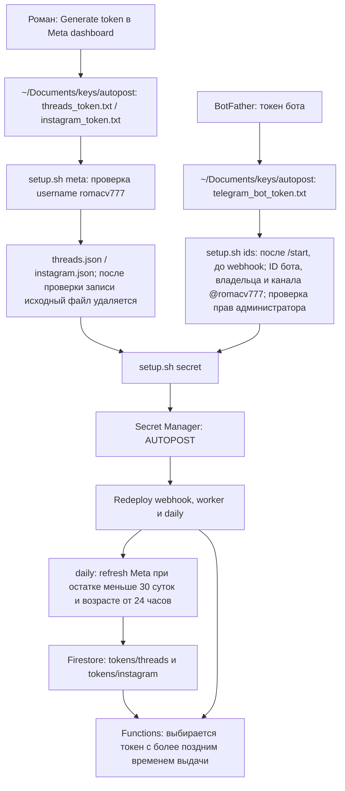
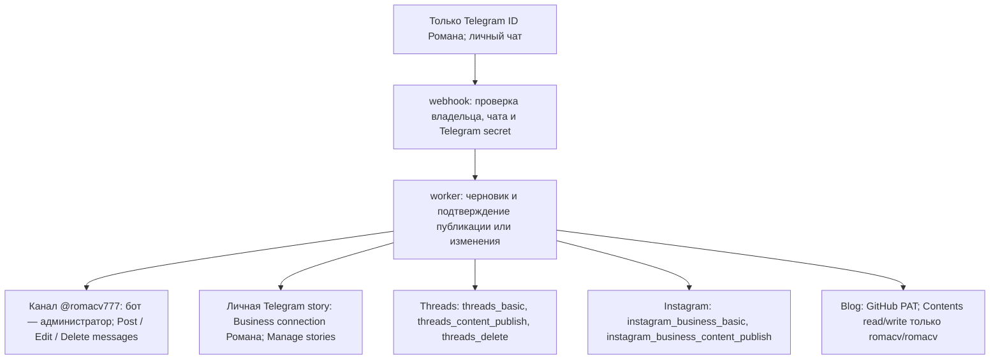
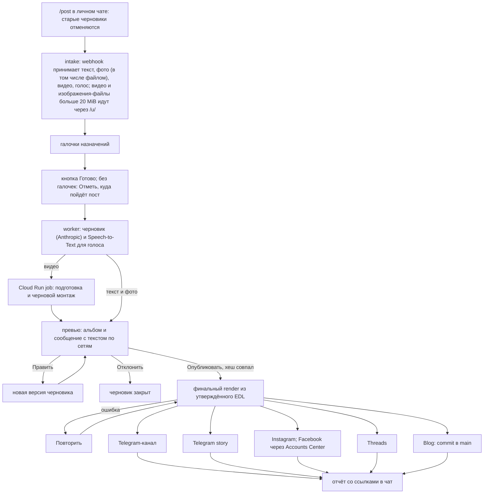

# Автопостер на Firebase

Роман отправляет боту текст, фото, голос или видео. Бот готовит черновик и финальные файлы, показывает их в личном чате и ждёт «Опубликовать». Подтверждение привязано к конкретным текстам и байтам медиа. Новый пост начинается командой /post, а фото, видео, голос или файл без открытого поста (после публикации, отмены или при операции над постом) тоже открывают новый пост без отмены черновиков, альбом даёт одно сообщение сбора. По /post бот отменяет открытые черновики («Отменяю старые черновики: …») и открывает пост; всё следующее (текст, фото, видео, голос, альбомы) попадает в него. Картинка, присланная файлом, считается фото. Под сообщением сбора галочки назначений: «Сторис» (Instagram и личная Telegram story, одна галочка), «Instagram-пост», «Instagram Reels», «Threads», «Telegram-канал», «Сайт» (показаны только настроенные). Кнопка «Готово» без галочек отвечает «Отметь, куда пойдёт пост.»; иначе запускает черновик (видео — монтаж), «Отменить» сбрасывает. Нажатая кнопка гасится строкой статуса, клавиатуры старше последней убираются, пока бот работает, в чате идёт индикатор действия. Превью называет назначения, которые не подходят к материалу: «Не пойдёт в <название>: <причина>.». Превью — один альбом с каждым файлом один раз (подпись: куда файл идёт) и сообщение «Черновик «…»: куда пойдёт» с текстом по сетям человеческими названиями и кнопками (длиннее 4096 знаков — несколько сообщений, кнопки на последнем). Без открытого поста любое сообщение (текст, скриншот, голос) правит текущий черновик (пока он готовится, текст, оканчивающийся на «?», не становится правкой, а получает текущую стадию; правку пишут утверждением), голос перед правкой распознаётся Speech-to-Text, без черновика текст получает просьбу отправить /post. Фото вместе с видео «Готово» принимает: клипы идут с фото в карусель Instagram и Threads, альбом Telegram-канала и отдельными историями по файлу, в Сайт только фото, Reels собирается из клипов подряд; клип длиннее 60 с обрезается, а что не пойдёт, превью называет. Пока пост открыт, в личном чате закреплено сообщение «Открыт пост «…»: N фото, M клипов»; оно обновляется при смене набора и снимается и удаляется по «Готово», «Отменить» или новому /post. Ответ на превью любого черновика (текст, скриншот, голос) правит его; /post сбрасывает ожидание правки. Повторное «Править» отвечает, что правка ждётся. «Это новый пост» под ответом переносит сообщение в новый пост. «Править» создаёт новую версию. «Отклонить» закрывает черновик. Ответ (в том числе с цитатой) на сообщение превью правит только эту цель. Вопрос или замечание к готовому превью без просьбы что-то менять получает короткий ответ модели по состоянию поста, черновик не меняется. После нажатия «Опубликовать» любое сообщение получает статус публикации (готово N из M, ошибки целей); после публикации текст идёт модели: ответ или превью правки. Заметка в превью — короткий русский текст о решении, которое нужно знать Роману. Точный текст Романа для надписи, места или подписи используется дословно (с его эмодзи) и не проверяется на язык; новые черновики и монтаж с Threads всегда несут `threads_tag` (уходит в Threads как `topic_tag`; 1–50 знаков, без #, пробела, точки и &; [topic_tag](https://developers.facebook.com/docs/threads/posts)). Фото для ig-post, threads и tg-channel рендерятся 1:1 (до 1440x1440), окно кропа выбирается по энергии краёв без вызова модели; сториз 1080x1920. Текст оверлея, плашка места и титры монтажа принимают эмодзи (📍 рисуется глифом пина), субтитры монтажа остаются простым текстом. Посты, созданные до этого изменения, тега не имеют и публикуются и правятся без него. При tg-channel вместе с tg-story канал публикуется первым, а сториз несёт ссылку-область на пост канала. Отказ сториз читается «Telegram не принял историю (<причина>)». Каждый ответ бота называет пост или черновик.

| Часть | Назначение |
| --- | --- |
| webhook | Functions 2nd gen, Python 3.12, us-central1; проверяет Telegram secret, владельца и личный чат; сохраняет update и outbox транзакцией |
| worker | 2 GiB, 540 с, одна попытка и один параллельный вызов; черновики, превью, публикация и приём результатов job |
| autopost-render | Приватный Cloud Run job (сам шлёт «отправляет видео» каждые 4 с и правит статус-сообщение со стадией и временем; токен бота из секрета `AUTOPOST_NOTIFY`, только `secretAccessor` у SA render): подготовка аудио, кадров и контактных листов, затем черновой монтаж (540×960, ultrafast, без H.265, один файл на одинаковые таймлайны) и после «Опубликовать» финальный; 2 CPU, 2 GiB, 1800 с, без retries |
| Firestore Native | Состояния, версии, checkpoints, tokens и outbox; us-central1, клиентские rules deny all |
| Storage | Приватный resromcom-493b4-autopost: inbox/ и media/, поколения объектов и SHA-256, lifecycle 2 дня |
| daily | Каждые 15 минут восстанавливает зависшие публикации; обслуживание выполняет раз в день в 06:00 выбранной зоны, по умолчанию Asia/Makassar |
| budget_kill | Отдельный codebase и SA; бюджет $1 отвязывает billing |

Код расположен в `autopost/functions/`; промпт — `autopost/functions/draft-agent.md`, накопленные правила — `autopost/functions/EXPERIENCE.md`. Черновик создаёт Anthropic с одной коррекцией JSON и локальной валидацией. Каждый пост — один диалог с моделью в Firestore (`conversations/<item>`, `-montage`, `-fix`): правка добавляет ход только с новыми правками, и модель меняет свой прошлый JSON; первая пара реплик хранится всегда, история обрезается на 200 КБ, кеш промпта стоит на системном промпте и последнем блоке, запись защищена ревизией. Диалог удаляют сброс, новый /post и «Отклонить»; публикация удаляет диалоги черновика и монтажа. Speech-to-Text V1 возвращает слова с таймкодами; резервирование в Firestore останавливает распознавание на 55 мин/месяц.

Альбом собирается с задержкой **10 с**; revision делает устаревшие задания неактуальными. Пост ограничен **1 GiB и 20 файлами**, файл по /u/ — 512 MiB. Для видео и изображений-файлов больше 20 MiB бот выдаёт ссылку /u/ на 15 минут; изображение после загрузки уменьшается до JPEG ≤2560 px, q90, с учётом EXIF-поворота (HEIC поддержан); «Новая ссылка» под сообщением со ссылкой выдаёт новую. Файлы выбираются по порядку списка. HMAC билета отделён от webhook secret, квитанция проверяет Origin, срок и HMAC, а upload_complete — файлы текущей revision (наличие, тип, размер).

Страница /u/ закрепляет endpoint `https://us-central1-resromcom-493b4.cloudfunctions.net/webhook` и bucket `https://storage.googleapis.com/resromcom-493b4-autopost/` в проверках и CSP. Произвольные run.app и чужие buckets не допускаются; после deploy сверить адрес webhook с этой настройкой.

Подготовка аудио/видео выполняется в Cloud Run: worker передаёт manifests объектов, а не весь пакет в памяти. Job извлекает FLAC, длительности, кадры раз в секунду и до 100 контактных листов. Монтаж проверяет источники, конечные числовые времена, границы клипов и субтитров. Каждый итоговый файл очищается от метаданных перед хешированием. Reel/канал/Threads — до 90 с, stories — до 60 с. Черновой render показывает тот же EDL в низком качестве; хеш подтверждения покрывает spec, EDL и версию настроек render, не байты черновика. После «Опубликовать» собирается финал из утверждённого EDL и публикуется без повторного просмотра; ошибка финала ничего не публикует и даёт «Повторить». Финальный render делает crop/blur pad, loudnorm, встроенные субтитры и необязательные заголовки места с пином (до 20 на таргет, 28 символов); Reel — H.264/AAC 1080×1920, Telegram story — H.265/AAC 720×1280 до 30 MB. Обложка входит в длительность. Перед подтверждением нужно проверить изображение и звук черновика.

Планирование `at` ограничено **36 часами** от проверки; lifecycle не гарантирует наличие материала после долгого ожидания подтверждения. При отсутствии объекта бот сообщает «Материал истёк. Пришли файлы заново.»; при загрузке возможен вариант «Материал истёк или не загружен. Пришли файлы заново.».

Состояния: drafting → previewed → approved → running → done/partial/failed. Истёкший материал завершает публикацию в failed без кнопки повтора. Правка снимает старое подтверждение; повторные update/callback не публикуют материал снова. Перед внешним действием сохраняется pending checkpoint, после ответа — done с ID. Явный HTTP 4xx помечает попытку failed; сетевой сбой оставляет pending до ручной сверки результата у платформы. «Повторить» из partial пропускает готовые шаги и не снимает pending. Контейнеры Meta ERROR/EXPIRED пересоздаются без сброса успешного publish checkpoint. Blog после PATCH 422 сверяет текущую ссылку ветки.

Каждый **15-минутный tick** переводит финальный рендер старше 30 минут без результата в partial с кнопкой повтора и running старше 10 минут в partial и предлагает повтор с сохранёнными результатами. Ежедневное обслуживание также восстанавливает недоставленные результаты prepare/render. Подписанные GET привязаны к generation и действуют 60 минут; проверяются полным GET, Content-Type, длиной и SHA-256. Неудачная проверка публичной ссылки не вызывает повторную публикацию.

Рабочие и личные посты Telegram публикуются по-русски в одном публичном канале @romacv777 «Канал им. Ресенчука Романа» (`tg-channel`). Отчёт содержит ссылки `https://t.me/romacv777/<message_id>`; рабочие Instagram/Threads и blog — по-английски, личные тексты — по-русски. Blog использует атомарный Git Data commit в main от Roman Resenchuk с GitHub noreply; отчёт сверяет Action по commit SHA и title статьи. Непроверенный URL отмечается явно. Бот не публикует в Facebook: автопубликация Accounts Center включена для story и постов, но проверено 2026-10-27 — медиа, опубликованное ботом через API, в профиль Facebook «Roman Res» не попадает; делиться нужно вручную из Instagram. Ссылку `ig-story`, вычисленную из shortcode, обязательно открыть на телефоне **при первой живой story**; до этой проверки её корректность не подтверждена.

## Токены, разрешения и тестировщики

В Meta два приложения: **resrom threads** с use case **Access the Threads API** и разрешениями `threads_basic`, `threads_content_publish`, `threads_delete`; **resrom posting** с **Manage messaging & content on Instagram → API setup with Instagram login** и `instagram_business_basic`, `instagram_business_content_publish`. Meta запрещает «instagram» в имени приложения, а Threads нельзя объединить с другими use cases в одном приложении.

Оба приложения остаются в development mode: пользоваться ими могут только аккаунты с ролью в приложении. Тестировщик — сам Роман, аккаунт **@romacv777**, с ролями **Threads Tester** и **Instagram Tester**; других тестировщиков нет. Приглашение нужно принять: Threads — **threads.com → Settings → Website permissions → Invites**, Instagram — **instagram.com/accounts/manage_access → Tester invites**. App Review не нужен: приложения работают только с собственным аккаунтом Романа.

Токен даёт приложению доступ к аккаунту в пределах выданных разрешений. Роль тестировщика разрешает использовать приложение в development mode, но не заменяет разрешения токена.

`meta` не заменяет отличающийся JSON: перед заменой токена удалить соответствующий `threads.json` или `instagram.json`. Короткий Threads token обменивается с `threads_app_secret.txt`; Instagram token нужен свежий из Generate token. Refresh сохраняет имеющиеся scopes, но не выдаёт новые. `meta` сохраняет фактически выданные разрешения из [debug_token data.scopes](https://developers.facebook.com/documentation/threads/troubleshooting/debug-access-token) в `threads.json.scopes`. Runtime использует scopes выбранного токена.

Перед действием runtime сверяет личность бота, канал и его права, владельца активного Business connection; для Meta — @romacv777 и сохранённый user_id, для Instagram также тип Creator. Instagram правится и удаляется вручную; разрешения публикации этого не меняют.

Вручную повторить настройку нужно при отзыве токена: например, после смены пароля, удаления приложения или `/revoke` в BotFather. Сгенерировать новый токен, сохранить в соответствующий файл в `~/Documents/keys/autopost`, для Meta выполнить `setup.sh meta` после удаления старого JSON; для Telegram заменить `telegram_bot_token.txt`. Затем `setup.sh secret` и redeploy webhook, worker и daily. Для каждого провайдера runtime и daily выбирают более новый токен: issued_at из AUTOPOST сравнивается с максимумом issued_at/refreshed_at из Firestore. При равенстве выбирается Firestore. Новый AUTOPOST после ручной генерации выигрывает у старого Firestore, последующий refresh снова делает Firestore новее. Ручная правка Firestore не нужна. Daily пропускает refresh истёкшего токена и отправляет Роману строку с провайдером и «нужен новый токен: Generate, setup.sh meta, secret» не чаще одного раза в сутки для каждого провайдера.

## Настройка

Права каждого SA и причины grants перечислены в [reference.md](../setup/reference.md). Runtime читает только AUTOPOST через secretAccessor, без удаления версий и инвентаризации функций. Для подписания выдан только signBlob на собственном SA; для запуска job — run и runWithOverrides на конкретном job. Speech V1 не требует отдельной Speech role: см. официальные [longrunningrecognize](https://docs.cloud.google.com/speech-to-text/docs/reference/rest/v1/speech/longrunningrecognize) и [operations.get](https://docs.cloud.google.com/speech-to-text/docs/reference/rest/v1/operations/get).

1. Включить Blaze, выполнить `autopost/setup/setup.sh apis`, затем `infra` и `iam`. Подключить существующий bucket к Firebase Storage. Подготовить Telegram Post messages/Manage stories, два Meta-приложения и роли тестировщика, GitHub PAT и Anthropic prepaid с auto-reload off и месячным limit.
2. Создать приватные файлы по [keys-template.md](../setup/keys-template.md). До регистрации webhook отправить боту /start и выполнить `setup.sh ids`: команда заполнит Telegram ID и channels.json, проверив права администратора и Post/Edit/Delete messages в @romacv777. В **resrom threads → User Token Generator** и **resrom posting → Manage messaging & content on Instagram → API setup with Instagram login → Generate token** для @romacv777 получить токены, сохранить в threads_token.txt / instagram_token.txt и выполнить `setup.sh meta`. Команда проверяет личность, не печатает значения и не заменяет отличающийся JSON. Threads проверяется через debug_token; короткий токен требует threads_app_secret.txt. Instagram token должен быть только что получен через Generate token: сразу выполнить `meta`, которая запишет issued_at = now и expires_at = now + документированные 60 суток. Повтор с тем же токеном сохраняет исходные времена. Setup не вызывает refresh; позже daily пытается обновить токен, когда до expires_at осталось меньше 30 суток токен ещё не истёк и с issued_at/refreshed_at прошли хотя бы 24 часа. Подробности и официальные ссылки — в шаблоне ключей. `meta` сохраняет data.scopes из debug_token в threads.json; refresh сохраняет scopes выбранного токена. Явный `setup.sh secret` всегда добавляет версию из переданных владельцем файлов, не читая существующее значение.
3. Выполнить `setup.sh render`; выложить functions, Firestore/Storage rules и Hosting. Проверить приватность worker/job и публичность webhook. Сверить URL, повторить `iam` и `infra` для resource grants и настроек после deploy. После первого deploy измерить суммарный размер Artifact Registry.
4. После каждого изменения AUTOPOST выполнить redeploy webhook, worker и daily, проверить работу и привязанные версии. Вручную уничтожить прежнюю неиспользуемую версию: [AUTOPOST → Versions](https://console.cloud.google.com/security/secret-manager/secret/AUTOPOST/versions?project=resromcom-493b4), Actions → Destroy. Free tier — **6 активных версий**; автоматической очистки нет. Не уничтожать версии, ещё используемые deployments: [Firebase secrets](https://firebase.google.com/docs/functions/config-env?gen=2nd), [Secret Manager](https://docs.cloud.google.com/secret-manager/docs/destroy-secret-version).
5. Выполнить `setup.sh webhook` с тем же секретом и URL; pending updates сохраняются. Бюджет $0.01 только для писем; бюджет $1 с порогами 50/90/100% и Pub/Sub budget-alerts запускает kill switch.
6. Drill пройден 2026-10-27 с SIMULATE_DEACTIVATION=True («Billing disabled. (Simulated)»); теперь режим боевой. **`setup.sh budget-test` в боевом режиме отключит billing**: только после возврата True и deploy. Отключение billing переводит проект на [Spark](https://firebase.google.com/docs/projects/billing/firebase-pricing-plans): Pub/Sub, Cloud Run, deploy функций и bucket autopost недоступны до возврата Blaze, данные bucket сохраняются; Hosting и Firestore там не описаны. Уведомления запаздывают и не ограничивают расходы: [Google sample](https://docs.cloud.google.com/billing/docs/how-to/disable-billing-with-notifications).

Первый запуск проверять последовательно с отдельным подтверждением Романа: Telegram text/photo/album/story, Threads, Instagram post/story/Reel и автопубликация в Facebook, blog, большой MP4 через /u/, /post, кнопки «Готово» и «Отменить», правки, отклонение и несколько целей. Проверить доступность медиа для Meta, конечные кодеки, длительность, звук и все ссылки на телефоне.

Free tier не гарантирует нулевой счёт. Scheduler: 3 бесплатных задания на billing account. Cloud Build оставляет исходники в staging bucket: после первого deploy проверить его и удалить staged sources. Artifact Registry: превышение 0.5 GB суммарно вероятно; cleanup старше суток не является лимитом размера. Secret Manager: 6 активных версий; Speech V1 Standard: первые 60 минут, приложение резервирует до 55. Soft delete bucket отключён (0). Render, builds, egress и другие workloads billing account учитываются отдельно. После первого deploy и живого запуска проверить размер образов и Billing report: [free tier](https://docs.cloud.google.com/free/docs/free-cloud-features), [Cloud Run](https://cloud.google.com/run/pricing), [Speech](https://cloud.google.com/speech-to-text/pricing), [Secret Manager](https://cloud.google.com/secret-manager/pricing).

## Правка и удаление опубликованного

Под отчётом о публикации кнопки «Править» (текст без открытого поста правит черновик) и «Удалить»; ответ текстом на сообщение опубликованного поста тоже правка. Слова в тексте командами не считаются. Бот показывает изменённые строки или список целей удаления и ждёт отдельного подтверждения с хешем. Канал требует дополнительно Edit messages и Delete messages; альбом правится по подписи первого сообщения и удаляется целиком, а старые альбомы без всех ID удаляются вручную. Business story правится с исходным медиа (при истёкшем Storage потребуется ручная правка), Threads правится через удаление и повторную публикацию: превью предупреждает, что лайки и комментарии пропадут. Нужен новый токен со scopes threads_basic, threads_content_publish, threads_delete и их список в scopes выбранного токена; refresh не добавляет разрешения. Перед удалением проверяется [threads_publishing_limit](https://developers.facebook.com/docs/threads/troubleshooting?locale=en_US#retrieve-quota-limits) (delete_quota_usage/delete_config), максимум 100 за 24 часа. Исходное медиа проверяется до удаления; истёкший материал нужно прислать заново. Новый ID и ссылка сохраняются. Instagram caption edit и DELETE не поддерживаются официальным API с Instagram Login: [IG Media](https://developers.facebook.com/docs/instagram-platform/reference/instagram-media). Правка и удаление выполняются вручную по ссылке. Blog меняется одним атомарным Git Data commit; удаление убирает статью из индекса, RSS и sitemap. Отчёт содержит результат и ссылку каждой цели. Повтор пропускает готовые цели; pending требует ручной сверки.

Stories в канале не поддерживаются: Bot API публикует stories только для business-аккаунта, а пользовательскую сессию Роман 2026-10-27 решил не подключать. [postStory](https://core.telegram.org/bots/api#poststory), [editStory](https://core.telegram.org/bots/api#editstory) и [deleteStory](https://core.telegram.org/bots/api#deletestory) требуют `business_connection_id`, а не `chat_id`; поддерживается только личная Business story (`tg-story`) с правом `can_manage_stories`. Канальные права Post/Edit/Delete stories для обычных постов не нужны.

## Как это устроено: для iOS-разработчика

Таблица частей, версий и лимитов — выше; здесь только роли и аналогии.

| Часть | iOS-аналог | Где работает | Кто даёт доступ и как | Что запускает |
| --- | --- | --- | --- | --- |
| webhook | push, будящий приложение | Cloud Functions, публичный URL | Telegram secret в заголовке; пускает только владельца в личном чате | Telegram POST на каждое сообщение и нажатие кнопки |
| worker | фоновая задача `BGTaskScheduler` | Cloud Functions, вызывается из Cloud Tasks (очередь `worker`) | runtime SA с `cloudtasks.enqueuer` у webhook; одна попытка, один параллельный вызов | задача от webhook или от результата job |
| autopost-render | тяжёлый фоновый процесс (Share Extension с ffmpeg) | Cloud Run job, приватный | `run` и `runWithOverrides` только на этот job, у SA worker | worker, когда нужен монтаж или финальный файл |
| Firestore | Core Data / CloudKit | Firestore Native | правила клиента deny all; сервер идёт через SA | читают и пишут webhook, worker, daily |
| Storage | папка Application Support | Cloud Storage, приватный bucket | SA; внешним сервисам — подписанные GET на 60 минут | загрузки, `/u/` |
| Secret Manager `AUTOPOST` | Keychain | Secret Manager | `secretAccessor` у runtime SA; значения кладёт Роман | читается при старте функций |
| кнопки в Telegram | confirm alert | Telegram | токен бота, личный чат | подтверждение сверяется с хешем превью |
| daily | периодический `BGAppRefreshTask` | Cloud Scheduler → Cloud Functions | runtime SA | каждые 15 минут: восстановление; раз в день: обслуживание, refresh токенов |
| budget_kill | аварийный выключатель | Pub/Sub → отдельная функция | собственный SA с правом отключить billing | уведомление бюджета |
| Threads, Instagram | внешние API-сервисы | Meta APIs | токен приложения Meta (см. раздел про токены); Facebook без API, через Accounts Center | worker при публикации |
| Telegram story | действие от имени пользователя | Telegram Bot API | Business connection Романа, `can_manage_stories` | worker при публикации |

Различие с iOS: функции не хранят состояние между вызовами, всё важное лежит в Firestore (как в `ModelContext`, который сохраняют до выхода из процесса). Очередь на одну попытку: упавший шаг не повторяется сам, бот показывает «Повторить».

### Стоимость в месяц

| Статья | Сумма | Источник |
| --- | --- | --- |
| Google (Functions, Firestore, Storage, Tasks, Scheduler, Secret Manager) | $0 в пределах free tier | план; не проверено живым Billing report |
| Speech-to-Text | $0, резерв 55 из 60 бесплатных минут | план и раздел «Настройка» |
| Cloud Run job, Artifact Registry сверх 0.5 GB, сборки, egress | оценка, не измерено | в плане не указано; проверить Billing report после живых запусков |
| Anthropic | около $0.03 за черновик (оценка из плана), лимит $5 в месяц, prepaid без auto-reload | план |
| Meta, Telegram, GitHub | $0 | API без платы за использование (не проверялось отдельно) |
| Предохранитель | бюджет $1, пороги 50/90/100%, затем billing отключается | раздел «Настройка», шаг 5 |

Решения, которые остаются за Романом: ответы на живые тесты из конца раздела «Настройка», уничтожение старых версий AUTOPOST и перевыпуск токенов Meta раз в 60 суток при сбое refresh.
